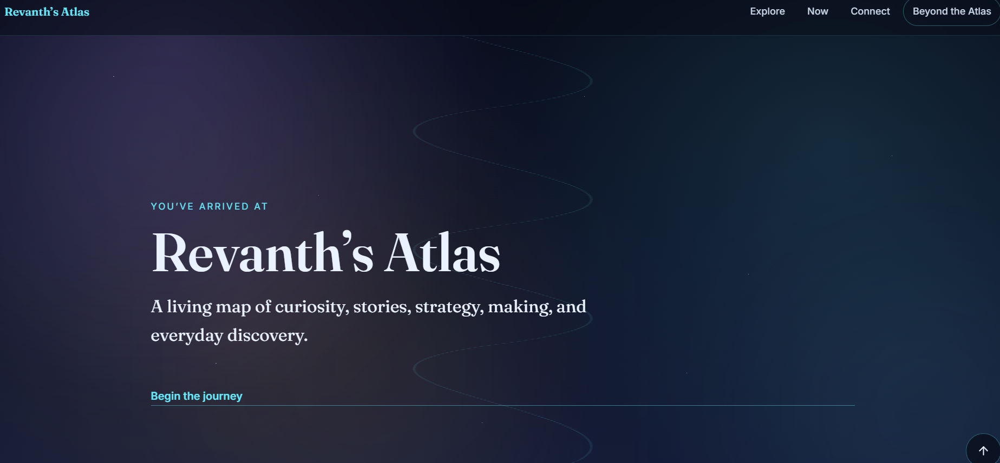

# Hi, I’m Revanth Kumar Matta 👋

### Curious builder exploring stories, strategy, data, making, and everyday discovery.

I enjoy turning ideas into useful digital experiences, learning through small experiments, and understanding how systems, stories, and everyday choices work.

By profession, I work in healthcare operations and quality assurance — a world of processes, details, and finding better ways to do things.

 

## 🌱 Currently

 

## 🚀 Projects

<table>
  <tr>
    <td width="100%">
      
       
      <h3 align="center">Revanth’s Atlas</h3>
      

        A living map of curiosity, stories, strategy, making, and everyday discovery.
      

      

        
      

    </td>
  </tr>
</table>

### 🧩 Offline HTML Tools

These are lightweight, browser-based HTML tools. They are currently offline projects rather than publicly hosted sites.

<table>
  <tr>
    <td width="50%">
      <h3 align="center">Resume Template Builder</h3>
      

        A browser-based tool for creating and customising clean resumes.
      

      

        
      

    </td>
    <td width="50%">
      <h3 align="center">Job Fit Smart Analyzer</h3>
      

        A personal tool for reviewing job descriptions, checking role fit, and preparing outreach.
      

      

        
      

    </td>
  </tr>
</table>

 

## 🧭 Explore

 

## 🛠️ Skills & Tools

`SQL` · `Tableau` · `Power BI` · `Advanced Excel` · `HTML` · `CSS` · `JavaScript` · `AI Tools` · `Digital Marketing` · `Design Systems` · `Process Improvement` · `Quality Assurance`

 

## ✨ Curious About

- Stories, imagination, and “what if” questions  
- Data, patterns, and visual storytelling  
- Useful digital products and practical problem-solving  
- Strategy, systems thinking, and better decisions  
- Design, user experience, and thoughtful interfaces  
- Games, immersive worlds, and steady improvement  
- Food, well-being, and simple everyday systems  
- Personal knowledge systems and continuous learning  

 

## 📫 Open to Discussions

I’m open to conversations about ideas, projects, learning, healthcare operations, quality, design, or anything interesting in between.

